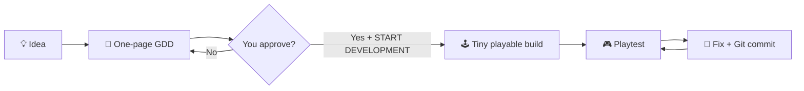

# 🎮 Vibe-Code Your First Game — Summer Engine + Godot

> **A beginner-friendly, GBA-inspired classroom workshop.** Turn an idea into a small playable 2D or 3D game with an AI coding agent. No prior programming, Git, or 3D modeling experience required to start — but playtesting, iteration, and learning still matter.

**Workshop deck:** [`GBA_Vibe_Coding_Workshop.pptx`](GBA_Vibe_Coding_Workshop.pptx)  
**Copy-ready instructions:** [Master prompt](#the-universal-master-prompt) · [Starter prompts](#beginner-starter-prompts) · [Genre examples](#game-genre-example-prompts) · [One-page GDD](#one-page-game-design-document-template)

## 👾 What you will learn

By the end, you should be able to:

1. Explain what an AI *coding agent* does (and why plain browser chat isn't enough for local development).
2. Install and connect Summer Engine or start with ordinary Godot, with a compatible local coding agent.
3. Pick a template, or create a new game based on a Game Soul design brief.
4. Write and approve a **one-page game design document (GDD)** before development.
5. Ask the agent for a **tiny playable prototype**, test it, give useful feedback, and save progress with Git.
6. Know when advanced 3D assets, multiplayer, and Steam integration are worth the extra effort.

**Important:** AI can write code and generate assets, but cannot guarantee a fun, stable, completed, or commercially successful game. You are the game director and tester. Start small!

## 🧰 Get ready (student setup)

| What | Beginner explanation | Where |
|---|---|---|
| Windows or macOS PC | The computer where you'll create and run the game | [Summer install guide](https://docs.summerengine.com/essentials/installation) |
| **Summer Engine** *or* **Godot** | Game editor. Summer is a Godot-based editor with AI tooling. | [Summer](https://www.summerengine.com/) · [Godot](https://godotengine.org/) |
| **AI coding agent** | An AI that can work with local files, the terminal, and the editor | Codex, Claude Code, Gemini CLI, or another compatible agent |
| Summer account (if using cloud features) | Sign in through the official website; **never paste passwords or tokens in chat** | [Summer installation](https://docs.summerengine.com/essentials/installation) |
| Git | Your game's undo/history system | [Git downloads](https://git-scm.com/downloads) |
| One game idea | 1 action + 1 goal + 1 obstacle is enough | [Game examples](#game-genre-example-prompts) |

**Summer setup:** Follow the official [installation](https://docs.summerengine.com/essentials/installation) and [MCP setup](https://docs.summerengine.com/mcp/setup) guides. The guide also documents `npx -y summer-engine@latest install`, `login`, and `run` for supported CLI workflows. Commands and system requirements can change: use the current official page, not a copied command alone. Summer's asset-generation and account features may have usage charges; check the plan before using them.

**Plain Godot alternative:** Install [Godot](https://godotengine.org/), attach a compatible editor MCP (for example [Fennara](https://github.com/fennaraOfficial/fennara-godot-ai)) if desired, and use the same GDD/agent/Git workflow. You don't need paid cloud generation for a basic prototype.

### Five steps to your first playable game



1. **Describe the idea:** “A little robot pushes crates into glowing goals.”
2. **Choose a starting point:** Prefer a downloadable/open-source [Summer template](https://www.summerengine.com/templates/) with a verified repository and license. If it only creates a **Game Soul `.md`**, use it as a *design brief*, not source code.
3. **Review your GDD:** What does the player do? What counts as winning? What can you finish in one lesson?
4. **Say `START DEVELOPMENT`:** The agent installs only necessary dependencies, builds one working mechanic, then tests it.
5. **Play, critique, repeat:** “The jump feels slow; decrease airtime and keep the existing controls.” Ask for a tested Git commit.

> **Classroom target:** One character, one small level, one simple win/lose rule, and a restart button. Add music, effects, menus, new levels, or multiplayer *after* the first loop works.

## 🧠 The universal master prompt

Copy everything in the block into **your local AI coding agent**. The prompt is deliberately complete, but tells the agent to use **only tools needed** for your particular project.

```text
# UNIVERSAL AI GAME DEVELOPMENT — MASTER PROMPT

ROLE
Act as a seasoned professional Godot game developer, creative game designer, technical director, and commercially aware indie-game mentor. Apply studio-grade quality standards without claiming real personal credits or guaranteeing sales. Help a complete beginner make a fun, original 2D/2.5D/3D game using Summer Engine (Godot-based) or standard Godot. Favor small, finished games over ambitious unfinished ones. Minimize unnecessary tokens, downloads, cloud charges, and complexity.

CODING AGENT
Use a capable AI coding agent with real local filesystem, terminal, Git, and game-editor access: Codex, Claude Code, Gemini CLI, or an equivalent IDE/third-party agent. Ordinary browser chat without local tool access is not a sufficient development environment. Respect the user's preferred agent. Verify capabilities instead of assuming them.

ESSENTIAL ENGINE & EDITOR
Summer Engine: https://www.summerengine.com/
Install: https://docs.summerengine.com/essentials/installation
MCP: https://docs.summerengine.com/mcp/setup
Templates: https://www.summerengine.com/templates/
Godot: https://godotengine.org/
Optional Fennara MCP: https://github.com/fennaraOfficial/fennara-godot-ai
Read official install, MCP, compatibility, and asset documentation. Guide the user through Summer account sign-in via official authentication if needed, without requesting passwords. Explain free vs paid features and ask before spending credits. Use Fennara only when compatible and not duplicating Summer MCP functions.

DISCOVERY — BEFORE CODING
Ask what kind of game the user wants. They can attach MP4 gameplay videos, screenshots, concept art, novels, design docs, or legally held reference files. Analyze accessible references (with relevant timestamps for video); do not claim to have viewed inaccessible files. Discuss genre, player goal, mechanic, art style, controls, story, target hardware, single-player/co-op/PvP, and whether Steam multiplayer is truly needed.
Browse https://www.summerengine.com/templates/ together. Prefer downloadable/open-source templates with a verified GitHub repository, license, and compatible Godot version. If a template only provides a Game Soul .md, treat it as a creative brief, NOT as a cloned game. If nothing fits, start blank. Ask the user to select a template.

MANDATORY GDD APPROVAL
Produce an approximately ONE-PAGE Markdown GDD.md with: title/pitch, target player/platform, core loop, controls/mechanics, victory/failure, game modes/multiplayer, art/audio, full menu-to-restart flow, progression, tech/asset strategy, and a tiny first milestone. Add a Mermaid diagram when helpful. Show the complete GDD and revise it with the user. NEVER create or modify the game project until BOTH the GDD is approved AND the user explicitly says: START DEVELOPMENT. Pre-development software/account setup requires user permission.

FRAMEWORKS — INSTALL ONLY IF NEEDED
Netfox: https://github.com/foxssake/netfox
Netfox docs: https://foxssake.github.io/netfox/latest/
Co-op Anything: https://github.com/cranebeaker/coop-anything
Game AI Kit: https://github.com/boscocp/game-ai-kit
Novel-to-Game (narrative games): https://github.com/zenstory-ai/novel-to-game
REA (optional reference analysis): https://github.com/morluto/rea
Read each SELECTED framework's official README, docs, relevant source, tutorials, and examples before implementation. For Netfox multiplayer, systematically read the COMPLETE documentation set and apply its actual installed-version conventions. Netfox supports rollback-related infrastructure but does not magically make Godot physics deterministic. Use fixed ticks, reproducible/rollback-safe state as required, and verify sync under latency, packet loss, reconnects, and multiple instances. Use Co-op Anything skills where compatible, not as a replacement for Netfox. Reuse Game AI Kit for NPCs when useful; Novel-to-Game skills for story-rich genres; REA only when justified, legally and technically feasible. Independently recreate mechanics, not copyrighted game assets/code.

OPTIONAL STEAM MULTIPLAYER — ASK FIRST
GodotSteam GDExtension: https://godotengine.org/asset-library/asset/2445
Docs: https://godotsteam.com/getting_started/introduction/
Repository: https://codeberg.org/godotsteam/godotsteam.git
Netfox + GodotSteam reference: https://github.com/AtomicSponge/godot-multiplayer-example
Ask if Steam online multiplayer is needed, and explain it can require substantial extra implementation/testing/tokens and Steamworks setup. If approved: verify Summer/Godot/plugin versions; INSTALL the actual GodotSteam GDExtension in the project (not merely clone a demo); configure Netfox and Steam correctly; clone the example into repos/ and reuse compatible MIT-licensed parts; test Steam initialization, lobbies/invites/P2P, at least two accounts, exported builds, Windows/Steam Deck, and disconnects. Host migration is a separate feature, only if requested and proven. Never mistake a sample App ID for a production ID.

ASSET GENERATION — STRICT PRIORITY
1) Summer Engine built-in asset solution (preferred, ask before paid credits).
2) KILN: https://github.com/lukasgolino/kiln (simple procedural/low-poly 3D, rigs/animation where supported).
3) Godogen: https://github.com/htdt/godogen and Godogen Assets: https://github.com/htdt/godogen_assets (advanced optional local models and Kimodo animation workflow). Check GPU, VRAM, RAM, CUDA/driver, OS, disk space, README, dependencies, and obtain approval before large downloads or isolated environment setup.
4) Blender MCP: https://github.com/ahujasid/blender-mcp and Tripo MCP: https://github.com/Tripo-Developer/tripo-mcp (complex modeling/cleanup/rigging when needed).
Choose only suitable tools. For 2D, generate or reuse legally licensed sprites, tilemaps, UI, and audio. Reuse skeletons/animations and validate all asset imports, collisions, scale, licenses, and game performance. Keep model weights and generator servers outside releases.

OPTIONAL RESEARCH LIBRARIES
AI & 3D bookmarks: https://trello.com/b/pGPoSXsP/ai-3d
Digital humans/embodied AI bookmarks: https://trello.com/b/Fh8cneze/digital-human-virtual-embodied-intel
Browse only relevant resources; do not automatically download all linked repos. Verify license and actual access.

GIT, WORKSPACE AND STRUCTURE
After approval, confirm exact workspace. Set up Git for beginners, configure identity only using user-approved details, .gitignore, a development branch, and commit every TESTED milestone. Do not overwrite existing changes, rewrite history, use unrelated Conda environments, or push publicly without approval.
Clone the chosen open-source template as the main project when available, preserving history. Place additional reference clones in root repos/ with .gdignore; install active Godot addons in root addons/; maintain docs/DEPENDENCIES.md with URLs/licenses/versions. Avoid nested repos being accidentally committed; choose a documented submodule or ignore strategy.
Keep ALL game-specific content under a root child folder named after the game, e.g. MyGame/scenes, MyGame/scripts, MyGame/assets, MyGame/ui, MyGame/tests. Keep project.godot, addons/, repos/, docs/, AGENTS.md, GDD.md, and Git metadata at the project root. Preserve Godot UIDs and template paths when relocating; test immediately afterward.
Create concise AGENTS.md specifying approved workspace, engine/version, folder structure, framework conventions, build/test commands, Git safety, and project status. Read it every session. Keep GDD.md and optional GameSoul.md current.

DEVELOPMENT AND QUALITY
After START DEVELOPMENT: create ONE small playable mechanic first, then controls/camera, feedback, win/lose, restart, basic menus, art/audio, and polish. Use the game editor/MCP to run and visually inspect, review logs, fix regressions, and compare supplied videos where applicable. Commit each working milestone. Run real multiplayer tests when multiplayer is approved. Target Windows and Steam Deck by default when feasible; support controllers where relevant. Ship independent game builds without requiring dev-only MCP, Python servers, or local AI generators.
Explain uncertainties, failures, license/cost concerns, and unsupported features. Ask only when an important permission, scope decision, or blocker requires it. Do not claim untested features are working.


SOULSLIKE / HEAVY 3D COMBAT STARTER
Recommended starter: https://github.com/catprisbrey/Cats-Godot4-Modular-Souls-like-Template
For a 3D Soulslike or character-action game, consider this as the main starting project instead of recreating all combat systems. Its README describes dodge rolls, parrying/blocking, targeting, root-motion, enemies, and animation assets. Note that the author flags the existing v2 codebase as awaiting a major v3 replacement; verify the current release, integration compatibility, and license before choosing it. This does not automatically provide multiplayer or a full Devil-May-Cry-style combo system. Read the README and test a clean import first.

BLENDER IMPORT FIX
If Godot/Summer reports that Blender 3.0+ is required to import .blend files, verify Blender is installed, install it from https://www.blender.org/download/ with the user's permission if missing, and configure the Blender executable path in Godot's import prompt or editor settings. On Windows select blender.exe, not the Blender install directory. Reimport assets and verify animations/materials. Do not disable .blend importing merely to hide the error if the template requires those files.

BEGINNER GAME IDEA HELP
The beginner need NOT already know what GDD means (Game Design Document, a simple one-page game plan). If no idea: offer 2–3 tiny concepts based on interests and help choose one. If they have an idea: turn it into a short, plain-language GDD automatically. Show the draft, explain the goal/rules/controls in everyday words, and ask for review. Never require the student to write a GDD unaided.

PUBLIC REPO / SHARED TEACHING CHAT
Helpful example chat: https://chatgpt.com/share/6b047749-5fcc-83ec-822e-3a76af146a33
Students unfamiliar with Git may simply paste the public teaching-repository URL into a local coding agent and ask it to read README.md and MASTER_PROMPT.md. The agent must verify what it can access and explain if the URL cannot be read.

STARTING INSTRUCTION
First: confirm a capable local coding agent; guide Summer installation/account/MCP if chosen; ask for a game idea and optional MP4 references; help choose a verified template; discuss optional multiplayer; draft a one-page GDD and request review. Wait for explicit GDD approval and START DEVELOPMENT before touching project files.
```


## 🎮 New to game design? AI can write the GDD for you

A **GDD (Game Design Document)** is just a one-page plan describing your game's goal, controls, rules, look, and what the player does. You do **not** need to know how to make one. Say this to your local coding agent:

```text
I have never designed a game. Ask me about games I enjoy, then suggest 3 small beginner-friendly ideas. Help me choose one and WRITE a one-page GDD for me in plain English. Show it for my review. Do not code until I approve it and say START DEVELOPMENT.
```

If you already have an idea, say: "I want a game about [your idea]. Turn it into an achievable one-page GDD, and explain your choices like I'm new to game design."

### A 3D Soulslike / character-action starting point

**Use [Cat's Godot 4 Modular Souls-like Template](https://github.com/catprisbrey/Cats-Godot4-Modular-Souls-like-Template)** (not the earlier combat prototype). Its documented v2 feature set includes parry/block, dodging, root-motion, enemy targeting and over 110 animations. The author warns that a substantially different v3 is planned, so inspect the current release, license and compatibility first. This is a combat baseline, not automatic online multiplayer or a finished CAG game.

```text
Design a small original third-person Soulslike arena using https://github.com/catprisbrey/Cats-Godot4-Modular-Souls-like-Template as the preferred open-source starter. Read the README and verify the current version and license. Reuse existing movement, lock-on, dodge, parry and combat systems. Start with one enemy and one boss encounter. Help me approve a one-page GDD before cloning or modifying anything.
```

**If Godot asks for Blender:** the editor may show "Blender 3.0+ is required to import '.blend' files." Ask your coding agent to check for Blender, install it with permission from https://www.blender.org/download/, select the correct Blender executable (`blender.exe` on Windows) in the prompt, reimport the models and test animations. Do not disable Blender import if the project needs its `.blend` assets.

### For students who don't know Git

You can paste **this public GitHub repository URL** into your local coding agent (once your instructor has published it) and say: "Read its README.md and MASTER_PROMPT.md, guide me through setup, and help me invent a game idea." No manual cloning is required if your agent can fetch the repository.

**Example teaching conversation:** [https://chatgpt.com/share/6b047749-5fcc-83ec-822e-3a76af146a33](https://chatgpt.com/share/6b047749-5fcc-83ec-822e-3a76af146a33). This is an optional reference link, not a substitute for the README or a local coding agent.

## 🚀 Beginner starter prompts

### First 2D game

```text
I want to make a tiny 2D pixel-art platformer called Star Hopper in Godot/Summer Engine. One character collects 5 stars, avoids 2 enemies, and reaches a door. Keyboard + controller, restart button, one level. Help me choose a free template and prepare a one-page GDD first. Do not start coding until I approve and say START DEVELOPMENT.
```

### First 3D game

```text
I want a small PS1-style 3D arena game called Crate Chaos. Four colorful original low-poly characters push or throw crates into goals. Start with one playable solo arena and a simple bot; add multiplayer later. Prefer Summer's asset tools, then KILN if needed. Suggest a template and show a one-page GDD before development.
```

### Improve a prototype

```text
Playtest my existing game using the connected editor. Report the three biggest problems affecting fun or usability, with evidence. Fix only the highest-priority issue, test it again, and create a Git commit. Do not rewrite the game or modify folders outside this project.
```

### Use an MP4 gameplay reference

```text
Use my attached gameplay.mp4 as a reference. Identify the visible camera behavior, player movement, game loop, UI transitions, and the most important timestamps. Make an ORIGINAL game inspired by those principles, not a copy of the original assets. First draft a one-page GDD for approval.
```

## 🎯 Game genre example prompts

Paste any of these **after the master prompt**. All examples begin with design/GDD approval, not immediate coding. Keep content original.

| Genre | Copy-ready example request |
|---|---|
| **2D Platformer** | “Design a one-level pixel-art platformer where a frog wall-jumps through a rainy clocktower. Include 3 checkpoints and a 90-second goal. Start with a GDD.” |
| **2D Metroidvania** | “Design a small 2D metroidvania set inside a mechanical whale. One ability unlocks a shortcut. Build only one interconnected area for the MVP.” |
| **2D Roguelike** | “Design a top-down 2D roguelike with a 5-minute run, 3 enemy types, 2 weapons and one upgrade choice. Show the loop and GDD.” |
| **Bullet Hell** | “Design a 2D space shooter with one boss, readable projectile patterns, 3 lives and score chasing. Make a controller-friendly MVP.” |
| **Puzzle / Cozy** | “Design a cozy 2D café puzzle about sorting magical tea ingredients. 6 short levels, clear hints and a satisfying finish.” |
| **Visual Novel** | “Design a branching mystery visual novel with 3 characters, 5 short scenes and 2 endings. Consider Novel-to-Game skills; present a narrative flowchart and GDD.” |
| **2D Fighting** | “Design a simple local two-player fighting prototype with 2 original characters, light/heavy attacks, block and a round timer. Separate game logic from animations.” |
| **3D Platformer** | “Design a low-poly 3D platformer about a wind-up toy climbing a giant desk. One room, moving platforms, collectible gears and a goal bell.” |
| **3D Horror** | “Design a PS1-style first-person horror game in a deserted subway. One pursuer, 3 keys, no combat and a 15-minute level. Show the full game flow.” |
| **3D Party Game** | “Design an original 4-player crate-throwing party game inspired by classic PS1 minigames. Start offline with one arena, bots, win/lose, results and rematch; discuss Netfox online play as phase 2.” |
| **3D FPS** | “Design a compact retro arena shooter with one map, 2 weapons, 3 bots and pickups. Responsive movement comes before visual polish.” |
| **3D Racing** | “Design a low-poly kart time-trial game with one loop track, drift boost, checkpoints and a ghost replay. Test handling before online racing.” |
| **Co-op Survival** | “Design a 2-player co-op survival prototype with one cabin, one night, collectible fuel and one monster. Ask whether online or Steam lobbies are worth the complexity.” |
| **Monster Hunt + Cooking** | “Design an original gothic monster-hunting-and-cooking game. Start with one monster, one hunt, ingredient collection and one recipe. Use a Game Soul and a one-page GDD; defer large-scale co-op.” |
| **RPG** | “Design a small top-down RPG village mystery with one quest chain, two NPCs, one combat encounter and a meaningful final choice.” |
| **Tower Defense / Strategy** | “Design a tower defense game with one lane, 3 towers, 3 enemy types and 5 waves. Prioritize readable information and balance.” |
| **Stealth** | “Design a top-down stealth game where a courier sneaks through one museum. Guards have vision cones and predictable patrols; start with one level.” |
| **Farming / Sim** | “Design a cozy 3D rooftop garden game with plant–water–harvest–sell gameplay and a seven-day calendar. One playable plot first.” |
| **Sports** | “Design a simple 2v2 arcade dodgeball game. Begin with local play and bots; assess Netfox rollback suitability separately.” |
| **Rhythm** | “Design a 2D original-music rhythm game with one 60-second song, 3 note lanes, clear timing windows and performance feedback.” |

### Example: optional Steam multiplayer expansion

```text
The approved offline arena prototype works. Please explain costs and extra testing for Steam multiplayer. If I approve, read ALL Netfox documentation, install the GodotSteam GDExtension (not just a demo clone), review AtomicSponge/godot-multiplayer-example for reusable code, and propose a multiplayer implementation/testing plan before changing the game. Do not promise automatic physics determinism or host migration.
```

### Example: narrative + a provided game reference

```text
I have attached legally obtained reference footage and design notes from a classic party game. Study only observable mechanics, input feel, scoring and UI flow; use REA for deeper analysis only if justified and technically supported. Design an original game with original characters and art. Create the one-page GDD and Mermaid menu flow for review.
```

## 📄 One-page game design document template

Copy and fill in this form *before* starting development:

```markdown
# [GAME TITLE] — One-Page GDD

**One sentence:** A [genre] game where the player [action] to [goal].
**Audience / Platform:** [who plays? Windows, Steam Deck, etc.]
**Inspiration:** [references, not copyrighted assets]

## Core loop
[Start] → [Act] → [Reward / consequence] → [Try again]

## Controls & rules
- Move / interact / attack: [...] 
- Win when: [...] | Lose when: [...]
- Camera + viewpoint: [...]

## Modes and multiplayer
[Single-player first? Local / LAN / Netfox / Steam? Number of players?]

## Game flow
[Title → Play → Level → Win/Lose → Retry / Menu]

## Art and audio
[2D or 3D? palette? 3 asset needs? simple audio mood?]

## Tiny playable milestone
[ONE level, ONE main mechanic, ONE win/lose rule]

## Risks / dependencies
[Paid credits? multiplayer? local generator GPU? licenses?]

**Approval:** [ ] I reviewed this GDD. I will say START DEVELOPMENT separately.
```

## 🛠️ Helpful agent habits for beginners

**Instead of** “Make my whole dream game,” say **“Make one working level with movement, a goal and restart; playtest it.”** Then iterate:

- **Bug fix:** “The player falls through the ground after restarting. Reproduce it, fix it, retest and commit.”
- **Better feel:** “Movement feels slippery. Show the current acceleration and friction settings; adjust only those and let me playtest.”
- **UI polish:** “Make the title screen readable on a 1280×720 display with a controller.”
- **Asset safety:** “Use an original, reusable low-poly character; do not import copyrighted game assets.”
- **Session restart:** “Read AGENTS.md and GDD.md, summarize current Git status, and continue only the approved milestone.”

## 🗂️ Sample Godot project layout

```text
MyGame/                      ← Godot project root
├── project.godot
├── AGENTS.md                  ← rules and agent memory
├── GDD.md                     ← approved one-page plan
├── GameSoul.md                ← only if supplied
├── addons/                    ← actual installed Godot plugins
├── repos/                     ← optional references, .gdignore
│   └── .gdignore
├── docs/DEPENDENCIES.md       ← link + license + version
└── MyGame/                    ← ALL game-specific files
    ├── scenes/
    ├── scripts/
    ├── assets/
    ├── ui/
    ├── resources/
    └── tests/
```

**Git is your save system:** Commit after each tested milestone. Reference clones need an explicit ignore/submodule strategy to prevent accidental nested repositories in your game commits. Never upload secrets, commercial SDK keys, or large AI model weights.

## ⚠️ What beginners should know

| Myth | Reality |
|---|---|
| “One prompt makes any game.” | AI usually needs many playtest → feedback → repair cycles. |
| “Multiplayer is one checkbox.” | Networking adds authority, synchronization, latency, disconnects and testing. |
| “Netfox makes physics deterministic.” | Netfox has rollback features; you must verify that your simulation is reproducible. |
| “A Game Soul is a game template.” | Some Summer templates provide only a design document. |
| “AI-made art is automatically game-ready.” | Check licenses, style, rigging, performance, collisions and export formats. |
| “Steam multiplayer just needs a demo repo.” | Install GodotSteam GDExtension, configure Steamworks, and test with real clients. |
| “A browser chatbot can edit my computer.” | Only an agent with appropriate local tools and user permissions can do that. |

## 👩‍🏫 Suggested 60-minute class

| Time | Activity | Student outcome |
|---|---|---|
| 0–10 min | What vibe coding is + game idea | One clear 1-sentence pitch |
| 10–20 min | Editor, coding agent, Summer templates | Selected game starter |
| 20–30 min | One-page GDD + approval | Approved first milestone |
| 30–45 min | Generate one playable mechanic | First testable build |
| 45–55 min | Play, report one bug, retest, Git commit | Working checkpoint |
| 55–60 min | Share demo, next milestone | Actionable improvement plan |

> **Teacher's contingency plan:** If installation, sign-in, accounts, network access, or model credits block a student, pair them with a teammate or use a preinstalled Godot project. The goal is learning the iteration loop, not completing a complicated installation in class.

## 🔗 Official documentation and credits

**Read the currently published docs at build time; versions, pricing, and support may change.**

- [Summer Engine installation](https://docs.summerengine.com/essentials/installation), [MCP setup](https://docs.summerengine.com/mcp/setup), [templates](https://www.summerengine.com/templates/), [asset generation](https://docs.summerengine.com/art-system/ai-generation), [asset licensing](https://docs.summerengine.com/art-system/licensing)
- [Godot documentation](https://docs.godotengine.org/en/stable/)
- [Netfox source](https://github.com/foxssake/netfox) and [complete documentation](https://foxssake.github.io/netfox/latest/)
- [Co-op Anything](https://github.com/cranebeaker/coop-anything), [Game AI Kit](https://github.com/boscocp/game-ai-kit)
- [GodotSteam GDExtension](https://godotengine.org/asset-library/asset/2445), [GodotSteam docs](https://godotsteam.com/getting_started/introduction/), [Netfox+Steam example](https://github.com/AtomicSponge/godot-multiplayer-example)
- [KILN](https://github.com/lukasgolino/kiln), [Godogen](https://github.com/htdt/godogen), [Godogen Assets](https://github.com/htdt/godogen_assets), [Blender MCP](https://github.com/ahujasid/blender-mcp), [Tripo MCP](https://github.com/Tripo-Developer/tripo-mcp)
- [Fennara MCP](https://github.com/fennaraOfficial/fennara-godot-ai), [Novel-to-Game](https://github.com/zenstory-ai/novel-to-game), [REA](https://github.com/morluto/rea)
- [AI & 3D research board](https://trello.com/b/pGPoSXsP/ai-3d), [digital humans research board](https://trello.com/b/Fh8cneze/digital-human-virtual-embodied-intel)

### Publication note

This education kit is an independent learning resource, not an official Summer Engine, Godot, Steam, or third-party project. Names and trademarks belong to their owners. Verify upstream licenses before copying source, models or example project code. For public distribution, the repository owner should add a suitable license and classroom attribution details.

**Research date:** 24 November 2026. The shared ChatGPT conversation URL was not retrievable through the public viewer at preparation time; the supplied master-prompt conversation and accessible official documentation were used instead.
