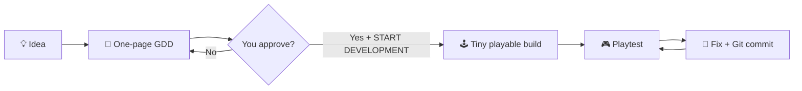

# 🎮 AI 游戏开发精通（AI GameDev Mastery）

**用 AI 制作属于你自己的 2D 或 3D 游戏——零编程经验要求！**

你不需要懂代码、3D 建模、动画或 Git 就能开始。

[PPTX](https://github.com/coursearchiver/AI_GameDev_Mastery/blob/main/GBA_Vibe_Coding_Workshop.pptx)

### 🚀 从这里开始——零基础新手

1. 安装 AI 编程代理（AI coding agent），例如 Codex、Claude Code 或 Gemini CLI。
2. 将此仓库 URL 提供给你的代理：
[https://github.com/coursearchiver/AI_GameDev_Mastery](https://github.com/coursearchiver/AI_GameDev_Mastery)
3. 对你的代理说：
"Read `MASTER_PROMPT.md` and guide me through making my first game. I am a complete beginner."（读取 `MASTER_PROMPT.md` 并指导我制作我的第一款游戏。我是零基础新手。）
4. 描述你梦想中的游戏，或让 AI 为你头脑风暴创意。
5. 审阅 AI 创建的一页式游戏设计文档（Game Design Document）。
6. 当你对计划满意时，说 **START DEVELOPMENT**。

### ⚡ 快速开始——已经有游戏想法？

改为让你的代理读取 `MASTER_ONESHOT_PROMPT.md`。

当你已经有清晰的游戏概念并希望采用更精简的工作流时使用此方式。

### 🎥 有喜欢的游戏？

你也可以附上 MP4 游戏实机视频、截图或其他参考资料，向 AI 展示你想创建的内容。

**你的职责：** 构想、试玩并提供反馈。

**AI 的职责：** 协助你设计、构建、调试和改进游戏。

https://chatgpt.com/share/6b052cef-880c-83ec-bc5b-494c76a403f1


> **双语版本 / Bilingual Edition (简体中文 + English)**  
> 中文优先帮助中国学生理解；保留英文原文、技术名称、命令与 URL，便于直接让 AI 编程代理执行。  
> **Language tip:** Ask your coding agent: “请用简体中文解释操作，但不要翻译代码、文件名和命令。”

# 🎮 用 AI 做你的第一款游戏 — Summer Engine + Godot

**零编程基础也能开始 / Beginner-friendly game development.** 本仓库包含幻灯片、主提示词、各种游戏类型的示例，以及 GDD 模板。你负责想创意和试玩；能操作电脑的 AI 编程代理协助写代码、运行和修改游戏。**不能保证一句提示词直接生成完整商业游戏**，请从小型可玩作品开始。

## 🚀 零基础学生：五步开始 / 5 Steps to Begin

1. **安装本地 AI 编程代理 / Install a coding agent：** Codex、Claude Code、Gemini CLI 或支持本地文件、终端、Git 和 MCP 的其它 AI 工具。普通网页聊天不能代替能操作电脑的软件代理。
2. **粘贴仓库 URL / Share the repository：** `https://github.com/coursearchiver/AI_GameDev_Mastery`。让代理先阅读 `MASTER_PROMPT.md`、README 和相关示例。
3. **优先安装 Summer / Summer first：** 按官方安装文档配置 **Summer Engine 桌面端 + CLI + MCP**；若无法使用，说明原因并征得你的同意后再用标准 Godot。登录/付费请使用官方页面，不要把密码粘贴给 AI。
4. **先构思，再审核 GDD / Review the game plan：** 告诉 AI 喜欢什么类型的游戏，或附上 MP4 游戏录像。让它提出三个容易完成的小点子，再写一页式 GDD（游戏设计文档：游戏目标、操作、流程和开发计划）。你批准后才进入开发。
5. **开始制作并试玩 / Build and playtest：** 输入 `START DEVELOPMENT`。让代理先做一个机制、实际运行、修 Bug、测试成功后用 Git 提交。

## 📋 中国学生可直接复制的启动提示词 / Copy-ready Chinese starter prompt

```text
我是完全零基础的游戏开发新手。请阅读这个教学仓库：
https://github.com/coursearchiver/AI_GameDev_Mastery
优先遵循 MASTER_PROMPT.md，并用简体中文一步一步向我解释。
使用具有本地文件、终端和 MCP 控制能力的 AI 编程代理。
默认安装并设置 Summer Engine 桌面版、CLI 和 MCP，不要擅自换成普通 Godot。
请先问我想做什么游戏；若我没有想法，给我三个范围合理的小创意。
欢迎我提供 MP4 视频、截图、小说或参考游戏。
协助挑选 Summer 模板，优先有可用 GitHub 源码的模板。
然后为我制作一页 GDD（游戏设计文档），让我审核；可以用 Mermaid 流程图说明。
未经我批准 GDD 且明确输入 START DEVELOPMENT，不得改动游戏项目。
得到批准后，代我处理 Git、依赖、制作、试玩与版本提交。
请从询问我喜欢哪些游戏开始。
```

## 🎲 游戏点子从哪里来？ / How to Get an Idea

**一个动作 + 一个目标 + 一个阻碍。** 例如：「用机器人把箱子推到目标点，同时躲避史莱姆」。让 AI 给出 3 个可在短时间做出原型的点子，并解释哪个最容易完成。

## 📄 GDD 是什么？ / What Is a GDD?

GDD = **Game Design Document，游戏设计文档**。它是约一页的游戏计划，不需要自己会写：让 AI 根据你的想法写，包括名称、玩法循环、操作、胜负条件、菜单流程、美术风格、是否联机及最小可玩版本。**先审核，不满意就让 AI 修改**。只有你同意并输入 `START DEVELOPMENT` 才开始制作。

## 🛠️ 选配工具与成本 / Optional Tools & Costs

- **Netfox：** 需要多人联机时研究；回滚 ≠ Godot 物理自动确定性。
- **GodotSteam：** Steam 大厅、邀请和 P2P 可能需要额外费用、设置、账号和大量调试。安装真正的 GDExtension，而不只是下载示例。
- **Game AI Kit：** 只为需要机器人/NPC 的游戏安装相关模块；可参考 `make release` 工作流。
- **3D 素材顺序：** Summer 内置 → KILN → Godogen（先看显卡/显存）→ Blender MCP / Tripo MCP。
- **格斗游戏：** 优先研究 `clintcan/3d-fighter`，保留现有回滚；是否增加 Netfox 或 Rollback in a Box 由用户决定。
- **动漫游戏：** 可另外阅读 `SPECIALIZED_3D_ANIME_PROMPT_cn.md`，按许可证判断是否适合用 Charakuru、Ensō。
- **魂类动作：** 可以先看 `Cats-Godot4-Modular-Souls-like-Template`；如果导入 `.blend` 提示缺少 Blender，经过用户同意后安装配置。

## 🔗 课程资源 / Course Resources

- [共享教学聊天 / Shared teaching chat](https://chatgpt.com/share/6b047749-5fcc-83ec-822e-3a76af146a33)
- [主提示词 / Master prompt](MASTER_PROMPT_cn.md)
- [游戏类型示例 / Genre prompts](GENRE_PROMPTS_cn.md)
- [一页式 GDD 模板 / GDD template](GDD_TEMPLATE_cn.md)
- [讲师指南 / Facilitator guide](FACILITATOR_GUIDE_cn.md)
- [双语幻灯片 / Bilingual slides](GBA_Vibe_Coding_Workshop_cn.pptx)

---

## English Reference / 英文完整参考资料

# 🎮 Vibe-Code Your First Game — Summer Engine + Godot

> **A beginner-friendly, GBA-inspired classroom workshop.** Turn an idea into a small playable 2D or 3D game with an AI coding agent. No prior programming, Git, or 3D modeling experience required to start — but playtesting, iteration, and learning still matter.

**Workshop deck:** [`GBA_Vibe_Coding_Workshop.pptx`](GBA_Vibe_Coding_Workshop.pptx)  
**Copy-ready instructions:** [Anime 3D specialty](SPECIALIZED_3D_ANIME_PROMPT.md) · [Master prompt](#the-universal-master-prompt) · [Starter prompts](#beginner-starter-prompts) · [Genre examples](#game-genre-example-prompts) · [One-page GDD](#one-page-game-design-document-template)

## 👾 What you will learn / 你将学会什么

By the end, you should be able to:

1. Explain what an AI *coding agent* does (and why plain browser chat isn't enough for local development).
2. Install **Summer Engine desktop + Summer CLI + Summer MCP** with a compatible local coding agent (standard Godot only by explicit fallback approval).
3. Pick a template, or create a new game based on a Game Soul design brief.
4. Write and approve a **one-page game design document (GDD)** before development.
5. Ask the agent for a **tiny playable prototype**, test it, give useful feedback, and save progress with Git.
6. Know when advanced 3D assets, multiplayer, and Steam integration are worth the extra effort.

**Important:** AI can write code and generate assets, but cannot guarantee a fun, stable, completed, or commercially successful game. You are the game director and tester. Start small!

## 🧰 Get ready (student setup) / 学生课前准备

| What | Beginner explanation | Where |
|---|---|---|
| Windows or macOS PC | The computer where you'll create and run the game | [Summer install guide](https://docs.summerengine.com/essentials/installation) |
| **Summer Engine (default)** | Install the desktop editor, CLI, and MCP together. Regular Godot requires your explicit approval as a fallback. | [Summer](https://www.summerengine.com/) · [CLI](https://www.summerengine.com/cli) · [MCP](https://www.summerengine.com/mcp) |
| **AI coding agent** | An AI that can work with local files, the terminal, and the editor | Codex, Claude Code, Gemini CLI, or another compatible agent |
| Summer account (if using cloud features) | Sign in through the official website; **never paste passwords or tokens in chat** | [Summer installation](https://docs.summerengine.com/essentials/installation) |
| Git | Your game's undo/history system | [Git downloads](https://git-scm.com/downloads) |
| One game idea | 1 action + 1 goal + 1 obstacle is enough | [Game examples](#game-genre-example-prompts) |

**Summer Engine is mandatory by default, not optional.** Ask your coding agent to install and verify the **desktop editor, CLI, and MCP** together before beginning game design. Start with the [official installation guide](https://docs.summerengine.com/essentials/installation), [Summer CLI](https://www.summerengine.com/cli), [Summer MCP](https://www.summerengine.com/mcp), and [CLI/agent source](https://github.com/SummerEngine/summer). Standard Godot is an **explicit opt-in fallback**, not the first choice.

**For the AI agent — copy this setup request:**

```text
Read MASTER_PROMPT.md first. Set up SUMMER ENGINE as my default engine: install the desktop application and Summer CLI, connect Summer MCP to my existing local coding agent, sign in through the official browser flow if needed, then run `npx -y summer-engine@latest doctor` and verify that MCP can actually access the running editor. Read https://docs.summerengine.com/essentials/installation, https://www.summerengine.com/cli, https://www.summerengine.com/mcp, and https://github.com/SummerEngine/summer. Do NOT install standard Godot instead without asking and receiving my approval. Do not create a game until you help me approve a one-page GDD and I say START DEVELOPMENT.
```

The documented CLI route starts with `npx -y summer-engine@latest install`, followed by browser sign-in (`login`) where needed and `setup <agent>` for the user's actual coding agent. The command syntax and supported agent IDs may change: use the **current official guide**. Summer CLI currently documents Node.js 18+, but verify the installed release's prerequisites. Heavy hosted generation may cost credits; ask before spending.

**Fallback only:** If Summer cannot run or is incompatible with a necessary template, the agent must explain why and **ask permission** before installing ordinary [Godot](https://godotengine.org/) and using another MCP such as [Fennara](https://github.com/fennaraOfficial/fennara-godot-ai). Classroom teachers may maintain a preinstalled Godot fallback for emergencies, but should not make it the default.

### Five steps to your first playable game



1. **Describe the idea:** “A little robot pushes crates into glowing goals.”
2. **Choose a starting point:** Prefer a downloadable/open-source [Summer template](https://www.summerengine.com/templates/) with a verified repository and license. If it only creates a **Game Soul `.md`**, use it as a *design brief*, not source code.
3. **Review your GDD:** What does the player do? What counts as winning? What can you finish in one lesson?
4. **Say `START DEVELOPMENT`:** The agent installs only necessary dependencies, builds one working mechanic, then tests it.
5. **Play, critique, repeat:** “The jump feels slow; decrease airtime and keep the existing controls.” Ask for a tested Git commit.

> **Classroom target:** One character, one small level, one simple win/lose rule, and a restart button. Add music, effects, menus, new levels, or multiplayer *after* the first loop works.


### 🌸 Optional: make a 3D anime, VTuber or gacha-style game

Use **[the specialized 3D anime prompt](SPECIALIZED_3D_ANIME_PROMPT.md)** *alongside* the universal master prompt, not instead of it. It explains how to evaluate [Charakuru](https://github.com/nanocle/Charakuru) for rigged VRM characters and [Ensō Engine](https://enso.mix3ddesign.com/) for anime/NPR environments. **Charakuru is source-available, not a generic open-source kit**; download its actual toolkit via [Releases](https://github.com/nanocle/Charakuru/releases), check the license, and never bundle it into this teaching repo. Confirm Ensō's Godot transfer on the version you're using; shader fidelity is not guaranteed. Start with one avatar and one room.

**Simple agent request:** “Read `MASTER_PROMPT.md` and `SPECIALIZED_3D_ANIME_PROMPT.md`. I want a small original anime-style 3D game. Explain the tools and costs, help me choose an idea, and make a one-page GDD before developing anything.”

## 🧠 The universal master prompt / 通用主提示词

Copy everything in the block into **your local AI coding agent**. The prompt is deliberately complete, but tells the agent to use **only tools needed** for your particular project.

```text
# UNIVERSAL AI GAME DEVELOPMENT — MASTER PROMPT

ROLE
Act as a seasoned professional Godot game developer, creative game designer, technical director, and commercially aware indie-game mentor. Apply studio-grade quality standards without claiming real personal credits or guaranteeing sales. Help a complete beginner make a fun, original 2D/2.5D/3D game using Summer Engine (Godot-based) by default; only use standard Godot after the user explicitly approves a fallback. Favor small, finished games over ambitious unfinished ones. Minimize unnecessary tokens, downloads, cloud charges, and complexity.

CODING AGENT
Use a capable AI coding agent with real local filesystem, terminal, Git, and game-editor access: Codex, Claude Code, Gemini CLI, or an equivalent IDE/third-party agent. Ordinary browser chat without local tool access is not a sufficient development environment. Respect the user's preferred agent. Verify capabilities instead of assuming them.

ESSENTIAL ENGINE & EDITOR — MANDATORY SUMMER FIRST
Summer Engine desktop: https://www.summerengine.com/
Official install guide: https://docs.summerengine.com/essentials/installation
Summer CLI: https://www.summerengine.com/cli
Summer MCP: https://www.summerengine.com/mcp
Summer CLI/agent source: https://github.com/SummerEngine/summer
Templates: https://www.summerengine.com/templates/
Optional Fennara MCP: https://github.com/fennaraOfficial/fennara-godot-ai

DEFAULT ENGINE RULE: Install and use Summer Engine, Summer CLI AND Summer MCP by default. Do NOT silently install regular Godot instead, treat regular Godot as equivalent, or merely write a Godot project without connecting Summer. Standard Godot is a FALLBACK ONLY: if Summer cannot be installed, is unsupported, or has a verified critical incompatibility, explain the problem, offer practical options, and get explicit user permission before switching. If the user already has Summer, verify it and repair/configure missing CLI or MCP pieces rather than installing another engine.

MANDATORY PRE-DEVELOPMENT SETUP (with user authorization; no game implementation yet):
1. Read the current Summer installation, CLI, MCP, compatibility and agent-specific documentation; check OS support and Node.js prerequisites. Verify terminal access and installed versions. The Summer CLI page currently documents Node.js 18+, but verify its latest guidance before installing.
2. Install missing Node.js if required, then install Summer Engine using the officially documented CLI: `npx -y summer-engine@latest install` (or the official OS installer if CLI installation fails). Ask for permission when installing system software.
3. Use official browser-based Summer account login when needed: `npx -y summer-engine@latest login`. Never request or expose passwords, tokens or credentials. Explain free vs paid features; never spend cloud credits without consent.
4. Identify the user's CURRENT agent (Codex, Claude Code, Gemini CLI, Cursor, etc.), then follow its supported Summer setup method. E.g. `npx -y summer-engine@latest setup codex --yes` for Codex or `npx -y summer-engine@latest setup claude-code --yes` for Claude Code, ONLY if the currently installed CLI supports that agent ID. Do not assume every third-party agent uses the same setup arguments. The CLI should install/configure agent skills and MCP rather than asking beginners to edit JSON manually.
5. Run `npx -y summer-engine@latest doctor` and address failed checks. Launch Summer via `npx -y summer-engine@latest run` or the installed desktop app; verify the running editor, the connected MCP tools, and a harmless editor read/inspection operation. Confirm real editor access, not merely successful installation of an npm package.
6. Report a beginner-friendly setup checklist: Desktop installed [yes/no]; CLI working [yes/no]; MCP connected to chosen agent [yes/no]; account state [signed in/not needed]; diagnostics [pass/fail]. Do not claim setup complete unless verified.
7. Only AFTER this setup, help the user explore templates and write the one-page GDD. Do not create/modify the game project until the GDD is approved AND the user says START DEVELOPMENT. A temporary diagnostic command or editor connection check must not become a game project.

Use Fennara only when compatible and useful without duplicating Summer MCP functionality. Summer remains the default development/editor environment throughout the project.
DISCOVERY — BEFORE CODING
Ask what kind of game the user wants. They can attach MP4 gameplay videos, screenshots, concept art, novels, design docs, or legally held reference files. Analyze accessible references (with relevant timestamps for video); do not claim to have viewed inaccessible files. Discuss genre, player goal, mechanic, art style, controls, story, target hardware, single-player/co-op/PvP, and whether Steam multiplayer is truly needed.
Browse https://www.summerengine.com/templates/ together. Prefer downloadable/open-source templates with a verified GitHub repository, license, and compatible Godot version. If a template only provides a Game Soul .md, treat it as a creative brief, NOT as a cloned game. If nothing fits, start blank. Ask the user to select a template.

MANDATORY GDD APPROVAL
Produce an approximately ONE-PAGE Markdown GDD.md with: title/pitch, target player/platform, core loop, controls/mechanics, victory/failure, game modes/multiplayer, art/audio, full menu-to-restart flow, progression, tech/asset strategy, and a tiny first milestone. Add a Mermaid diagram when helpful. Show the complete GDD and revise it with the user. NEVER create or modify the game project until BOTH the GDD is approved AND the user explicitly says: START DEVELOPMENT. Pre-development software/account setup requires user permission.

FRAMEWORKS — INSTALL ONLY IF NEEDED
Netfox: https://github.com/foxssake/netfox
Netfox docs: https://foxssake.github.io/netfox/latest/
Co-op Anything: https://github.com/cranebeaker/coop-anything
Game AI Kit: https://github.com/boscocp/game-ai-kit
Novel-to-Game (narrative games): https://github.com/zenstory-ai/novel-to-game
REA (optional reference analysis): https://github.com/morluto/rea
Read each SELECTED framework's official README, docs, relevant source, tutorials, and examples before implementation. For Netfox multiplayer, systematically read the COMPLETE documentation set and apply its actual installed-version conventions. Netfox supports rollback-related infrastructure but does not magically make Godot physics deterministic. Use fixed ticks, reproducible/rollback-safe state as required, and verify sync under latency, packet loss, reconnects, and multiple instances. Use Co-op Anything skills where compatible, not as a replacement for Netfox. Reuse Game AI Kit for NPCs when useful; Novel-to-Game skills for story-rich genres; REA only when justified, legally and technically feasible. Independently recreate mechanics, not copyrighted game assets/code.


GAME AI KIT — MODULAR GODOT ADDONS (WHEN NPC/BOT AI IS NEEDED)
Repository: https://github.com/boscocp/game-ai-kit
Official installation instructions: https://github.com/boscocp/game-ai-kit#using-one-addon-in-your-own-project
Read its README, relevant module docs, demo projects, license and release instructions. The kit includes reusable behaviour trees/GOAP/HTN, perception, steering, teamwork, search, utility decisions, planning, fighting opponent modelling, and more. Pick the smallest modules relevant to the approved GDD; avoid reinventing algorithms.
1. Prefer official published addon packages that match the engine version. If suitable packages are unavailable, clone into repos/game-ai-kit/ and follow the README's `make release` workflow. Check required tools, tests, clean Git HEAD, export conditions, and release artifacts; do not presume `make release` will succeed on every OS.
2. Release ZIPs contain `addons/<module>/`; unpack the required module and `ai_core-<version>.zip` into the GODOT PROJECT ROOT (`res://`), resulting in addons/ai_core/ and addons/<module>/. Do not replace project.godot or copy the demo project. The classes use `class_name` and do not require enabling an editor plugin.
3. Preserve Apache-2.0 LICENSE/NOTICE and VERSION included with packages and track pinned versions/commits in docs/DEPENDENCIES.md. Do not redistribute proprietary assets or unrelated demo content.
4. Integrate each selected module with the actual game's NPC actions, movement, navigation and combat. Test decisions in the running game and performance on target hardware. For networked/rollback games, keep gameplay-affecting decisions and random seeds deterministic or authoritative/synchronized, and test desyncs.
5. If the game needs no NPC AI, do not install the kit. Never install every module by default.

OPTIONAL STEAM MULTIPLAYER — ASK FIRST
GodotSteam GDExtension: https://godotengine.org/asset-library/asset/2445
Docs: https://godotsteam.com/getting_started/introduction/
Repository: https://codeberg.org/godotsteam/godotsteam.git
Netfox + GodotSteam reference: https://github.com/AtomicSponge/godot-multiplayer-example
Ask if Steam online multiplayer is needed, and explain it can require substantial extra implementation/testing/tokens and Steamworks setup. If approved: verify Summer/Godot/plugin versions; INSTALL the actual GodotSteam GDExtension in the project (not merely clone a demo); configure Netfox and Steam correctly; clone the example into repos/ and reuse compatible MIT-licensed parts; test Steam initialization, lobbies/invites/P2P, at least two accounts, exported builds, Windows/Steam Deck, and disconnects. Host migration is a separate feature, only if requested and proven. Never mistake a sample App ID for a production ID.

ASSET GENERATION — STRICT PRIORITY
1) Summer Engine built-in asset solution (preferred, ask before paid credits).
2) KILN: https://github.com/lukasgolino/kiln (simple procedural/low-poly 3D, rigs/animation where supported).
3) Godogen: https://github.com/htdt/godogen and Godogen Assets: https://github.com/htdt/godogen_assets (advanced optional local models and Kimodo animation workflow). Check GPU, VRAM, RAM, CUDA/driver, OS, disk space, README, dependencies, and obtain approval before large downloads or isolated environment setup.
4) Blender MCP: https://github.com/ahujasid/blender-mcp and Tripo MCP: https://github.com/Tripo-Developer/tripo-mcp (complex modeling/cleanup/rigging when needed).
Choose only suitable tools. For 2D, generate or reuse legally licensed sprites, tilemaps, UI, and audio. Reuse skeletons/animations and validate all asset imports, collisions, scale, licenses, and game performance. Keep model weights and generator servers outside releases.

OPTIONAL RESEARCH LIBRARIES
AI & 3D bookmarks: https://trello.com/b/pGPoSXsP/ai-3d
Digital humans/embodied AI bookmarks: https://trello.com/b/Fh8cneze/digital-human-virtual-embodied-intel
Browse only relevant resources; do not automatically download all linked repos. Verify license and actual access.

GIT, WORKSPACE AND STRUCTURE
After approval, confirm exact workspace. Set up Git for beginners, configure identity only using user-approved details, .gitignore, a development branch, and commit every TESTED milestone. Do not overwrite existing changes, rewrite history, use unrelated Conda environments, or push publicly without approval.
Clone the chosen open-source template as the main project when available, preserving history. Place additional reference clones in root repos/ with .gdignore; install active Godot addons in root addons/; maintain docs/DEPENDENCIES.md with URLs/licenses/versions. Avoid nested repos being accidentally committed; choose a documented submodule or ignore strategy.
Keep ALL game-specific content under a root child folder named after the game, e.g. MyGame/scenes, MyGame/scripts, MyGame/assets, MyGame/ui, MyGame/tests. Keep project.godot, addons/, repos/, docs/, AGENTS.md, GDD.md, and Git metadata at the project root. Preserve Godot UIDs and template paths when relocating; test immediately afterward.
Create concise AGENTS.md specifying approved workspace, engine/version, folder structure, framework conventions, build/test commands, Git safety, and project status. Read it every session. Keep GDD.md and optional GameSoul.md current.

DEVELOPMENT AND QUALITY
After START DEVELOPMENT: create ONE small playable mechanic first, then controls/camera, feedback, win/lose, restart, basic menus, art/audio, and polish. Use the game editor/MCP to run and visually inspect, review logs, fix regressions, and compare supplied videos where applicable. Commit each working milestone. Run real multiplayer tests when multiplayer is approved. Target Windows and Steam Deck by default when feasible; support controllers where relevant. Ship independent game builds without requiring dev-only MCP, Python servers, or local AI generators.
Explain uncertainties, failures, license/cost concerns, and unsupported features. Ask only when an important permission, scope decision, or blocker requires it. Do not claim untested features are working.


FIGHTER ROLLBACK SELECTION — the user decides

**Default:** Start with [clintcan/3d-fighter](https://github.com/clintcan/3d-fighter) and preserve its existing deterministic combat and rollback. **Do not install Netfox or Rollback in a Box just because they exist.** For wall-running, aerial combat, and breakable buildings, first prototype scripted movement and synchronized intact/damaged/collapsed collision states; cosmetic debris can remain visual-only.

**Only if a verified limitation arises**, explain the alternatives in plain English and ask the user to choose:

- **Keep the fighter's built-in rollback** — preferred when sufficient; no extra framework or wasted tokens.
- **Netfox** — consider only for a concrete networking need that justifies migrating/reworking the fighter's rollback; it does not inherently make rigid-body physics deterministic.
- **Rollback in a Box** — consider only if gameplay-critical moving rigid bodies or destructible rubble demand reproducible 3D physics, and prove integration in a small test.

**Do not choose or integrate either optional system without explicit user approval.** Never run two competing rollback systems. If approved, use one simulation clock, one snapshot/rollback authority, and multi-client/desync tests. GodotSteam is a separate optional lobby/transport decision.


```text
I have never designed a game. Ask me about games I enjoy, then suggest 3 small beginner-friendly ideas. Help me choose one and WRITE a one-page GDD for me in plain English. Show it for my review. Do not code until I approve it and say START DEVELOPMENT.
```

If you already have an idea, say: "I want a game about [your idea]. Turn it into an achievable one-page GDD, and explain your choices like I'm new to game design."


### A 3D Tekken-style fighter with rollback

**Recommended open-source starter:** [clintcan/3d-fighter](https://github.com/clintcan/3d-fighter). Its README documents one-on-one 3D combat, sidesteps, throws, combos, high/mid/low blocking, 60 Hz deterministic simulation, rollback netcode, online lobbies, training, replays, and automated headless tests. It currently lists **Godot 4.7**; verify the exact compatible version, tests and licenses before selecting it. Code is MIT-licensed, while original and third-party assets have separate attribution/licensing requirements.

**Should I install Netfox?** Not by default. This starter already has its own rollback implementation; layering another rollback manager could create competing prediction, snapshots and simulation clocks. Preserve its built-in architecture unless a specific missing feature justifies a carefully tested replacement.

**Can I add Steam multiplayer?** Potentially. [GodotSteam GDExtension](https://godotengine.org/asset-library/asset/2445) can be evaluated for Steam lobby/invite/P2P transport, but the existing online transport would need adapting. Do not replace or interfere with the game's deterministic rollback simulation. Two-account Windows/Steam Deck testing and export validation are mandatory.

**Beginner request:**

```text
I want to design a 3D one-on-one fighting game inspired by Tekken, with my own characters and moves. Please inspect https://github.com/clintcan/3d-fighter and its README, rollback tests, Godot version, and asset licenses. Use its existing deterministic rollback and fighting mechanics as the preferred foundation; don't add Netfox unless necessary. Ask whether I want Steam multiplayer, explaining the extra effort. Show me a one-page GDD and wait for my approval and START DEVELOPMENT before changing files.
```

### A 3D Soulslike / character-action starting point

**Use [Cat's Godot 4 Modular Souls-like Template](https://github.com/catprisbrey/Cats-Godot4-Modular-Souls-like-Template)** (not the earlier combat prototype). Its documented v2 feature set includes parry/block, dodging, root-motion, enemy targeting and over 110 animations. The author warns that a substantially different v3 is planned, so inspect the current release, license and compatibility first. This is a combat baseline, not automatic online multiplayer or a finished CAG game.

```text
Design a small original third-person Soulslike arena using https://github.com/catprisbrey/Cats-Godot4-Modular-Souls-like-Template as the preferred open-source starter. Read the README and verify the current version and license. Reuse existing movement, lock-on, dodge, parry and combat systems. Start with one enemy and one boss encounter. Help me approve a one-page GDD before cloning or modifying anything.
```

**If Godot asks for Blender:** the editor may show "Blender 3.0+ is required to import '.blend' files." Ask your coding agent to check for Blender, install it with permission from https://www.blender.org/download/, select the correct Blender executable (`blender.exe` on Windows) in the prompt, reimport the models and test animations. Do not disable Blender import if the project needs its `.blend` assets.

### For students who don't know Git

You can paste **this public GitHub repository URL** into your local coding agent (once your instructor has published it) and say: "Read its README.md and MASTER_PROMPT.md, guide me through setup, and help me invent a game idea." No manual cloning is required if your agent can fetch the repository.

**Example teaching conversation:** [https://chatgpt.com/share/6b047749-5fcc-83ec-822e-3a76af146a33](https://chatgpt.com/share/6b047749-5fcc-83ec-822e-3a76af146a33). This is an optional reference link, not a substitute for the README or a local coding agent.

## 🚀 Beginner starter prompts / 新手起步提示词

### First 2D game

```text
I want to make a tiny 2D pixel-art platformer called Star Hopper in Godot/Summer Engine. One character collects 5 stars, avoids 2 enemies, and reaches a door. Keyboard + controller, restart button, one level. Help me choose a free template and prepare a one-page GDD first. Do not start coding until I approve and say START DEVELOPMENT.
```

### First 3D game

```text
I want a small PS1-style 3D arena game called Crate Chaos. Four colorful original low-poly characters push or throw crates into goals. Start with one playable solo arena and a simple bot; add multiplayer later. Prefer Summer's asset tools, then KILN if needed. Suggest a template and show a one-page GDD before development.
```

### Improve a prototype

```text
Playtest my existing game using the connected editor. Report the three biggest problems affecting fun or usability, with evidence. Fix only the highest-priority issue, test it again, and create a Git commit. Do not rewrite the game or modify folders outside this project.
```

### Use an MP4 gameplay reference

```text
Use my attached gameplay.mp4 as a reference. Identify the visible camera behavior, player movement, game loop, UI transitions, and the most important timestamps. Make an ORIGINAL game inspired by those principles, not a copy of the original assets. First draft a one-page GDD for approval.
```

## 🎯 Game genre example prompts / 游戏类型示例

Paste any of these **after the master prompt**. All examples begin with design/GDD approval, not immediate coding. Keep content original.

| Genre | Copy-ready example request |
|---|---|
| **2D Platformer** | “Design a one-level pixel-art platformer where a frog wall-jumps through a rainy clocktower. Include 3 checkpoints and a 90-second goal. Start with a GDD.” |
| **2D Metroidvania** | “Design a small 2D metroidvania set inside a mechanical whale. One ability unlocks a shortcut. Build only one interconnected area for the MVP.” |
| **2D Roguelike** | “Design a top-down 2D roguelike with a 5-minute run, 3 enemy types, 2 weapons and one upgrade choice. Show the loop and GDD.” |
| **Bullet Hell** | “Design a 2D space shooter with one boss, readable projectile patterns, 3 lives and score chasing. Make a controller-friendly MVP.” |
| **Puzzle / Cozy** | “Design a cozy 2D café puzzle about sorting magical tea ingredients. 6 short levels, clear hints and a satisfying finish.” |
| **Visual Novel** | “Design a branching mystery visual novel with 3 characters, 5 short scenes and 2 endings. Consider Novel-to-Game skills; present a narrative flowchart and GDD.” |
| **2D Fighting** | “Design a simple local two-player fighting prototype with 2 original characters, light/heavy attacks, block and a round timer. Separate game logic from animations.” |
| **3D Platformer** | “Design a low-poly 3D platformer about a wind-up toy climbing a giant desk. One room, moving platforms, collectible gears and a goal bell.” |
| **3D Horror** | “Design a PS1-style first-person horror game in a deserted subway. One pursuer, 3 keys, no combat and a 15-minute level. Show the full game flow.” |
| **3D Party Game** | “Design an original 4-player crate-throwing party game inspired by classic PS1 minigames. Start offline with one arena, bots, win/lose, results and rematch; discuss Netfox online play as phase 2.” |
| **3D FPS** | “Design a compact retro arena shooter with one map, 2 weapons, 3 bots and pickups. Responsive movement comes before visual polish.” |
| **3D Racing** | “Design a low-poly kart time-trial game with one loop track, drift boost, checkpoints and a ghost replay. Test handling before online racing.” |
| **Co-op Survival** | “Design a 2-player co-op survival prototype with one cabin, one night, collectible fuel and one monster. Ask whether online or Steam lobbies are worth the complexity.” |
| **Monster Hunt + Cooking** | “Design an original gothic monster-hunting-and-cooking game. Start with one monster, one hunt, ingredient collection and one recipe. Use a Game Soul and a one-page GDD; defer large-scale co-op.” |
| **RPG** | “Design a small top-down RPG village mystery with one quest chain, two NPCs, one combat encounter and a meaningful final choice.” |
| **Tower Defense / Strategy** | “Design a tower defense game with one lane, 3 towers, 3 enemy types and 5 waves. Prioritize readable information and balance.” |
| **Stealth** | “Design a top-down stealth game where a courier sneaks through one museum. Guards have vision cones and predictable patrols; start with one level.” |
| **Farming / Sim** | “Design a cozy 3D rooftop garden game with plant–water–harvest–sell gameplay and a seven-day calendar. One playable plot first.” |
| **Sports** | “Design a simple 2v2 arcade dodgeball game. Begin with local play and bots; assess Netfox rollback suitability separately.” |
| **Rhythm** | “Design a 2D original-music rhythm game with one 60-second song, 3 note lanes, clear timing windows and performance feedback.” |

### Example: optional Steam multiplayer expansion

```text
The approved offline arena prototype works. Please explain costs and extra testing for Steam multiplayer. If I approve, read ALL Netfox documentation, install the GodotSteam GDExtension (not just a demo clone), review AtomicSponge/godot-multiplayer-example for reusable code, and propose a multiplayer implementation/testing plan before changing the game. Do not promise automatic physics determinism or host migration.
```

### Example: narrative + a provided game reference

```text
I have attached legally obtained reference footage and design notes from a classic party game. Study only observable mechanics, input feel, scoring and UI flow; use REA for deeper analysis only if justified and technically supported. Design an original game with original characters and art. Create the one-page GDD and Mermaid menu flow for review.
```

## 📄 One-page game design document template / 一页式 GDD 模板

Copy and fill in this form *before* starting development:

```markdown
# [GAME TITLE] — One-Page GDD

**One sentence:** A [genre] game where the player [action] to [goal].
**Audience / Platform:** [who plays? Windows, Steam Deck, etc.]
**Inspiration:** [references, not copyrighted assets]

## Core loop
[Start] → [Act] → [Reward / consequence] → [Try again]

## Controls & rules
- Move / interact / attack: [...] 
- Win when: [...] | Lose when: [...]
- Camera + viewpoint: [...]

## Modes and multiplayer
[Single-player first? Local / LAN / Netfox / Steam? Number of players?]

## Game flow
[Title → Play → Level → Win/Lose → Retry / Menu]

## Art and audio
[2D or 3D? palette? 3 asset needs? simple audio mood?]

## Tiny playable milestone
[ONE level, ONE main mechanic, ONE win/lose rule]

## Risks / dependencies
[Paid credits? multiplayer? local generator GPU? licenses?]

**Approval:** [ ] I reviewed this GDD. I will say START DEVELOPMENT separately.
```

## 🛠️ Helpful agent habits for beginners

**Instead of** “Make my whole dream game,” say **“Make one working level with movement, a goal and restart; playtest it.”** Then iterate:

- **Bug fix:** “The player falls through the ground after restarting. Reproduce it, fix it, retest and commit.”
- **Better feel:** “Movement feels slippery. Show the current acceleration and friction settings; adjust only those and let me playtest.”
- **UI polish:** “Make the title screen readable on a 1280×720 display with a controller.”
- **Asset safety:** “Use an original, reusable low-poly character; do not import copyrighted game assets.”
- **Session restart:** “Read AGENTS.md and GDD.md, summarize current Git status, and continue only the approved milestone.”

## 🗂️ Sample Godot project layout

```text
MyGame/                      ← Godot project root
├── project.godot
├── AGENTS.md                  ← rules and agent memory
├── GDD.md                     ← approved one-page plan
├── GameSoul.md                ← only if supplied
├── addons/                    ← actual installed Godot plugins
├── repos/                     ← optional references, .gdignore
│   └── .gdignore
├── docs/DEPENDENCIES.md       ← link + license + version
└── MyGame/                    ← ALL game-specific files
    ├── scenes/
    ├── scripts/
    ├── assets/
    ├── ui/
    ├── resources/
    └── tests/
```

**Git is your save system:** Commit after each tested milestone. Reference clones need an explicit ignore/submodule strategy to prevent accidental nested repositories in your game commits. Never upload secrets, commercial SDK keys, or large AI model weights.

## ⚠️ What beginners should know

| Myth | Reality |
|---|---|
| “One prompt makes any game.” | AI usually needs many playtest → feedback → repair cycles. |
| “Multiplayer is one checkbox.” | Networking adds authority, synchronization, latency, disconnects and testing. |
| “Netfox makes physics deterministic.” | Netfox has rollback features; you must verify that your simulation is reproducible. |
| “A Game Soul is a game template.” | Some Summer templates provide only a design document. |
| “AI-made art is automatically game-ready.” | Check licenses, style, rigging, performance, collisions and export formats. |
| “Steam multiplayer just needs a demo repo.” | Install GodotSteam GDExtension, configure Steamworks, and test with real clients. |
| “A browser chatbot can edit my computer.” | Only an agent with appropriate local tools and user permissions can do that. |

## 👩‍🏫 Suggested 60-minute class

| Time | Activity | Student outcome |
|---|---|---|
| 0–10 min | What vibe coding is + game idea | One clear 1-sentence pitch |
| 10–20 min | Editor, coding agent, Summer templates | Selected game starter |
| 20–30 min | One-page GDD + approval | Approved first milestone |
| 30–45 min | Generate one playable mechanic | First testable build |
| 45–55 min | Play, report one bug, retest, Git commit | Working checkpoint |
| 55–60 min | Share demo, next milestone | Actionable improvement plan |

> **Teacher's contingency plan:** If installation, sign-in, accounts, network access, or model credits block a student, pair them with a teammate or use a preinstalled Godot project. The goal is learning the iteration loop, not completing a complicated installation in class.

## 🔗 Official documentation and credits / 文档与署名

**Read the currently published docs at build time; versions, pricing, and support may change.**

- [Summer Engine installation](https://docs.summerengine.com/essentials/installation), [Summer CLI](https://www.summerengine.com/cli), [Summer MCP](https://www.summerengine.com/mcp), [Summer agent repository](https://github.com/SummerEngine/summer), [templates](https://www.summerengine.com/templates/), [asset generation](https://docs.summerengine.com/art-system/ai-generation), [asset licensing](https://docs.summerengine.com/art-system/licensing)
- [Godot documentation](https://docs.godotengine.org/en/stable/)
- [Netfox source](https://github.com/foxssake/netfox) and [complete documentation](https://foxssake.github.io/netfox/latest/)
- [Co-op Anything](https://github.com/cranebeaker/coop-anything), [Game AI Kit](https://github.com/boscocp/game-ai-kit)
- [GodotSteam GDExtension](https://godotengine.org/asset-library/asset/2445), [GodotSteam docs](https://godotsteam.com/getting_started/introduction/), [Netfox+Steam example](https://github.com/AtomicSponge/godot-multiplayer-example)
- [KILN](https://github.com/lukasgolino/kiln), [Godogen](https://github.com/htdt/godogen), [Godogen Assets](https://github.com/htdt/godogen_assets), [Blender MCP](https://github.com/ahujasid/blender-mcp), [Tripo MCP](https://github.com/Tripo-Developer/tripo-mcp)
- [Fennara MCP](https://github.com/fennaraOfficial/fennara-godot-ai), [Novel-to-Game](https://github.com/zenstory-ai/novel-to-game), [REA](https://github.com/morluto/rea)
- [AI & 3D research board](https://trello.com/b/pGPoSXsP/ai-3d), [digital humans research board](https://trello.com/b/Fh8cneze/digital-human-virtual-embodied-intel)

### Publication note

This education kit is an independent learning resource, not an official Summer Engine, Godot, Steam, or third-party project. Names and trademarks belong to their owners. Verify upstream licenses before copying source, models or example project code. For public distribution, the repository owner should add a suitable license and classroom attribution details.

**Research date:** 24 November 2026. The shared ChatGPT conversation URL was not retrievable through the public viewer at preparation time; the supplied master-prompt conversation and accessible official documentation were used instead.
